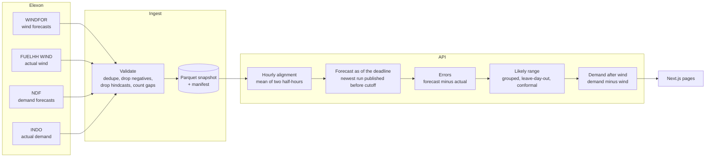

# Windward: GB wind forecasts for day-ahead buying

Windward answers three questions for a GB day-ahead buying team, for every delivery day in the pilot:

1. **What did the wind forecast say when bids closed?** It shows the newest Elexon WINDFOR forecast published before the chosen market's deadline (Nord Pool N2EX or EPEX SPOT), hour by hour.
2. **How far can I trust it?** It gives a likely range for each hour, a safer figure to plan on, and accuracy measured against metered output (FUELHH, `WIND`) at any lead time from 0 to 48 hours or at the deadline itself.
3. **How much demand is left for other sources?** It takes the national demand forecast available at the same deadline (NDF) and subtracts wind. The result is what gas, nuclear, imports and other sources must cover. It is shown for the expected wind and for the safer figure, and compared with actual demand (INDO).

The pilot covers purchase decisions made in January 2026, so delivery days run from 2 January to 1 February 2026.

Windward does not recommend a purchase volume. The demand figure is national, not one supplier's portfolio. A supplier's own demand forecast could be plugged in through the same path to turn it into a buy volume.

**Live app:** https://wq7zkt.vercel.app

## The three pages

| Page | What it shows |
| --- | --- |
| **Day ahead** (`/`) | For one market and delivery day: which forecast was available at the deadline, the day's wind forecast and safer figure, how forecast demand splits into planned wind, wind that may not arrive and other sources, hourly charts for wind and demand, how the day turned out, and every delivery day shaded by forecast miss. |
| **Accuracy** (`/accuracy`) | How far the forecast was from actual wind, either at the bidding deadline or a set number of hours ahead: a plain-language summary, a table of error measures, and charts of forecast against actual, misses by lead time, the spread of misses, and misses by time of day. |
| **How it works** (`/methodology`) | Each calculation step in plain language, the pilot's scope taken live from the API, and the limits of the analysis. |

## How the numbers are produced



### 1. Collect and validate

`python -m windesk.ingest` pulls four datasets from the Elexon Insights API in 7-day chunks, retrying with backoff:

| Dataset | Use | Resolution |
| --- | --- | --- |
| WINDFOR | Wind forecasts, every run kept with its publish time | Hourly |
| FUELHH (`WIND`) | Actual wind output | Half-hourly |
| NDF | National demand forecasts, every run kept with its publish time | Half-hourly |
| INDO | Actual national demand (same definition as NDF) | Half-hourly |

Duplicates are dropped, along with negative values and forecast rows published after the hour they describe (hindcasts). Missing half-hours are counted in `manifest.json`, never filled in.

### 2. Line up the hours

Each hourly actual is the mean of its two half-hours. That equals the hour's energy and matches the hourly blocks bought in the auction. If either half is missing, the hour is excluded. Using only the half-hour that starts on the hour changes the January gate-closure typical miss by about 18 MW, under 1%.

### 3. Pick the forecast a buyer actually had

One function, `forecast_as_of` in `analytics/selection.py`, does this for every view. For each target hour, it takes the forecast with the latest `publishTime` at or before a cutoff (a backward as-of join).

- **At the deadline:** the cutoff is the market's gate closure on the day before delivery (09:50 UK for N2EX, 09:20 UK for EPEX).
- **At a lead time of *h* hours:** the cutoff is the target hour minus *h*.

If the newest run before the cutoff doesn't cover an hour, the previous run that does is used and the hour is flagged `FALLBACK_RUN`. Demand forecasts go through the same selection, per half-hour, and are then averaged to hours.

### 4. Measure the misses

```
error = forecast − actual
```

A positive error means the forecast was too high, so a buyer who planned on it ends up short.

| Measure | Formula |
| --- | --- |
| Typical miss (MAE) | mean of \|error\| |
| RMSE | √(mean of error²) |
| Average error (bias) | mean of error |
| Half / nine in ten hours missed by less than | 50th / 90th percentile of \|error\| |
| Miss as a share of output (nMAE) | MAE ÷ mean actual |

### 5. Work out the likely range and safer figure

`analytics/decision.py` builds the range in five steps:

1. Take every hour at the deadline with both a forecast and an actual. **Leave out the day being shown**, so a day never shapes its own range.
2. Split those hours into three groups by forecast level (terciles), because misses grow as wind output rises.
3. In each group, take the residuals `actual − forecast` and pick the conformal order statistics at ranks ⌊(n+1)·0.1⌋ and ⌈(n+1)·0.9⌉. This is the finite-sample correction that stops a short history from making the range look too tight.
4. For each hour, add its group's offsets to the forecast to get P10 and P90, clipping P10 at zero. **P10 is the safer figure.**
5. Sum over the day:
   - wind that may not arrive = expected wind − safer figure
   - other sources (expected) = demand forecast − wind forecast
   - other sources (if wind is low) = demand forecast − safer figure

The API also checks the range against what happened, and the day-ahead page shows the result live: the share of pilot hours where actual wind reached the safer figure (target 90%), and the share inside P10 to P90 (target 80%).

## Running it

### Docker

```bash
docker compose up --build
```

- Web: http://localhost:3000
- API: http://localhost:8000/api/v1/meta (interactive docs at http://localhost:8000/docs)

### Local development

Requirements: Python 3.12 with [uv](https://docs.astral.sh/uv/), and Node 22 or later.

```bash
cd api
uv sync
uv run uvicorn windesk.main:app --port 8000

cd web
cp .env.example .env.local
npm install
npm run dev
```

Open http://localhost:3000. The web app proxies `/api/*` to `API_ORIGIN`, which is set in `.env.local`.

### Refreshing the data snapshot

```bash
cd api
uv run python -m windesk.ingest
```

## Deployment

The repo deploys to Vercel as one project using [Vercel Services](https://vercel.com/docs/services), configured in `vercel.json`:

- `/api/*` goes to the FastAPI service in `api/`, which runs as a Python function.
- Every other path goes to the Next.js service in `web/`.

Each push to `master` deploys. CI (`.github/workflows/ci.yml`) runs lint, type checks and builds, then builds the Docker Compose stack and smoke-tests it.

## Repository layout

```
.
├── vercel.json              Vercel Services: /api to api/, everything else to web/
├── docker-compose.yml       Runs both services locally (API health-checked before web starts)
├── .github/workflows/ci.yml Lint, type check, build, then Docker Compose build and smoke test
│
├── api/                     Python 3.12 · FastAPI · Polars
│   ├── pyproject.toml       Runtime deps, plus dependency groups: dev, ingest, serve
│   ├── Dockerfile
│   ├── data/                Validated snapshot: wind and demand Parquet files, manifest.json
│   └── windesk/
│       ├── main.py          App factory, error handlers, CDN cache headers
│       ├── settings.py      Every tunable (WINDESK_* env vars): windows, datasets, quantiles, buckets, horizons
│       ├── config/markets.json  Markets as data: venue, timezone, gate closure, delivery-day start
│       ├── markets.py       Gate closure and delivery hours (DST-aware: 23, 24 or 25 hour days)
│       ├── store.py         ForecastStore protocol + ParquetStore (swappable storage)
│       ├── desk.py          Application service: caching, windows, composes analytics per request
│       ├── schemas.py       Pydantic response contract (source of the OpenAPI spec)
│       ├── errors.py        Typed API errors
│       ├── analytics/       Pure functions over Polars frames
│       │   ├── alignment.py   Half-hours to hourly means
│       │   ├── selection.py   forecast_as_of: the one as-of join behind every view
│       │   ├── decision.py    Deadline day, likely range, demand after wind, quality flags
│       │   ├── accuracy.py    Lead-time and deadline reports, lead-time curve
│       │   └── metrics.py     MAE, RMSE, bias, percentiles, nMAE, histogram
│       ├── ingest/          Elexon client (chunked, retrying), validation, snapshot pipeline, CLI
│       └── routers/         /health, /meta, /markets, /decisions, /accuracy
│
└── web/                     Next.js 16 · React 19 · TypeScript · Tailwind v4 · shadcn/ui · evilcharts (ECharts)
    ├── openapi.json         API contract snapshot; TypeScript types are generated from it at build time
    ├── messages/en-GB.json  All UI text (next-intl); add a locale by adding a catalog
    ├── Dockerfile
    └── src/
        ├── app/             Routes: / (day ahead), /accuracy, /methodology
        ├── features/
        │   ├── decision/    Day summary, demand split, wind and demand charts, outcome, details, month strip
        │   ├── accuracy/    Basis toggle, lead-time slider, summary table, four charts
        │   └── methodology/ Step-by-step explanation plus live pilot scope from the API
        ├── components/      Layout, sections, fact lists, shared ECharts wrapper, states, theme, shadcn/ui
        ├── lib/api/         Typed openapi-fetch client plus a single SWR hook
        ├── lib/format/      Intl formatting for MW, GWh, %, dates and times in the market timezone
        └── i18n/            Locale config and request setup
```

## Design notes

- **One contract.** Pydantic schemas generate the OpenAPI spec, and the frontend generates its TypeScript types from that spec, so the two sides can't drift apart.
- **Built to grow.** Ingestion is separate from serving. Storage sits behind a protocol. Markets and tunables are configuration, not code. The API is stateless and sends CDN cache headers. View state lives in the URL, so a view can be shared by link.
- **Words live in one place.** The API returns only numbers, ISO timestamps and enum codes, and all UI text lives in one message catalog.
- **Data quality is visible.** Gaps are counted at ingest and flagged per hour, never filled.

## Use of AI tools

AI coding assistants were used during development, for drafting code, reviewing it and checking figures. The problem framing, methodology decisions and product scope were mine. Every figure shown in the app was checked against the source Elexon data.
